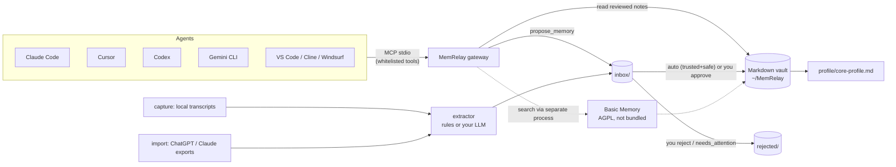

# MemRelay (忆桥)

[](https://github.com/theosunny/memrelay/actions/workflows/ci.yml)
[](LICENSE)
[中文](README.zh-CN.md)

**One memory for all your AI agents — and, over time, your digital twin.**

You tell Claude Code you prefer pnpm, tell Cursor your time zone, tell ChatGPT about your
project… and every agent forgets the moment you switch. MemRelay gives all of them **one
personal memory you own**: plain Markdown on your disk, every memory with its source.
By default MemRelay is **fully automatic with safety rails** — trusted high-confidence
captures and allowlisted agents land in the vault; secrets, injections, low confidence,
and supersedes wait in `needs_attention`. Human review is optional escalation (`strict`).

> Status: **v0.1.0** — usable preview for developers. Not on PyPI yet. Feedback welcome.
> 🧪 = implemented on `main` for the upcoming v0.2, not yet released.

## Features

| | Feature | Status |
|---|---|---|
| 🔌 | **Connect** agents over MCP: writes each agent's config, backs it up, one-command rollback; `connect --all` wizard | ✅ v0.1 |
| 📥 | **Capture** local agent history incrementally (Claude Code, Codex, Gemini CLI); `--watch` + autostart at login | ✅ v0.1 |
| 📦 | **Import** ChatGPT / Claude.ai data exports (auto-found in Downloads, asks first) | ✅ v0.1 |
| ✅ | **Review policy** (`auto` default / `assist` / `strict`): trusted+safe writes auto-apply; quarantine + inbox for the rest (CLI + local web UI) | ✅ v0.1 |
| 🛡️ | **Gateway**: whitelisted MCP tools, read-only for agents except `propose_memory`; secret redaction, injection flags | ✅ v0.1 |
| 🧭 | **Core profile** generated from reviewed memories, with links to sources | ✅ v0.1 |
| 🇨🇳 | China-friendly: HF mirror fallback for the embedding model; guided setup for 豆包 / Kimi / 千问 | ✅ v0.1 |
| ⏳ | Temporal memory (`valid_from` / `valid_to` / `superseded_by`), `recall(as_of=…)`, layered `events/YYYY/` | 🧪 v0.2 (on `main`) |
| 🔁 | Consolidation proposals (ADD / UPDATE / SUPERSEDE / NOOP), applied only on approval, never auto-delete | 🧪 v0.2 (on `main`) |
| 🪞 | Reflection (daily/weekly with citations), "Dream" consolidation with git snapshot + rollback | 🧪 v0.2 (on `main`) |
| ✍️ | Style card + decision principles from your own words; `answer_as_me` / `draft_as_me` (draft only) | 🧪 v0.2 (on `main`) |
| 📏 | Fidelity eval harness ("does the twin answer like me?") | 🧪 v0.2 (on `main`) |
| 🌐 | Share a scoped "ask my twin" link, A2A, mobile share sheet, browser extension | 🗓 planned |

## How it works



- **Storage & search** are done by [Basic Memory](https://github.com/basicmachines-co/basic-memory),
  launched as a separate program over MCP stdio. MemRelay never imports or ships it.
- MemRelay adds what was missing around it: the review inbox, the policy gateway, client
  connectors, capture/import, and the persona layer.

More: [docs/architecture.md](docs/architecture.md). How MemRelay relates to OpenViking, Supermemory, Basic Memory and Mem0: [docs/comparison.md](docs/comparison.md).

## Supported clients

| Client | Auto-connect (writes MCP config) | Capture history | Notes |
|---|---|---|---|
| Claude Code | ✅ `~/.claude.json` | ✅ `~/.claude/projects/**.jsonl` | |
| Cursor | ✅ `~/.cursor/mcp.json` | ❌ | chat history is an undocumented SQLite DB |
| Claude Desktop | ✅ macOS / Windows; Linux community path | ❌ | quit the app before connecting |
| Windsurf (Cascade) | ✅ `~/.config/devin/mcp_config.json` | ❌ | |
| Codex CLI / IDE | ✅ `~/.codex/config.toml` (comments preserved) | ✅ `~/.codex/sessions/**/rollout-*.jsonl` | honours `CODEX_HOME` |
| Gemini CLI | ✅ `~/.gemini/settings.json` | ✅ `~/.gemini/tmp/*/chats/session-*.jsonl` | |
| VS Code (GitHub Copilot) | ✅ `~/.copilot/mcp-config.json` | ❌ | |
| Cline (CLI) | ✅ `~/.cline/data/settings/cline_mcp_settings.json` | ❌ | |
| Cline (VS Code extension) | ✅ only if its storage folder exists | ❌ | secondary sources |
| 豆包 / Kimi / 通义千问 desktop | 🧭 guided: prints the JSON + steps, writes nothing | ❌ | no official config path found |
| ChatGPT / Claude.ai (web) | — | 📦 via data export import | |

Every path and its source: [docs/client-config-paths.md](docs/client-config-paths.md).

## Quick start

Requires [uv](https://docs.astral.sh/uv/getting-started/installation/) and Python ≥ 3.11.

**macOS / Linux**

```bash
uv tool install basic-memory      # storage/search backend (AGPL-3.0, installed separately)
uv tool install "git+https://github.com/theosunny/memrelay#subdirectory=packages/core"
memrelay init
memrelay connect --all            # discover agents, preview each change, confirm
```

**Windows (PowerShell)**

```powershell
powershell -ExecutionPolicy ByPass -c "irm https://astral.sh/uv/install.ps1 | iex"
uv tool install basic-memory
uv tool install "git+https://github.com/theosunny/memrelay#subdirectory=packages/core"
memrelay init
memrelay connect --all
```

Restart your agents, then ask one of them "what do you know about me?".

**In mainland China:** Basic Memory downloads a small embedding model from Hugging Face on
first use. MemRelay checks whether `huggingface.co` is reachable and, if not, points
`HF_ENDPOINT` at `https://hf-mirror.com`. If you set `HF_ENDPOINT` yourself, MemRelay leaves it
alone; `hf_endpoint = "off"` in `config.toml` disables the check. For a faster `uv` install
you can also set `UV_INDEX_URL` to a PyPI mirror you trust.

## Common commands

```bash
memrelay capture all              # Claude Code + Codex + Gemini CLI → vault (auto) or inbox
memrelay status                   # review.mode, inbox / needs_attention, recent auto-applied
memrelay autostart install --dry-run   # show the launchd / systemd / Task Scheduler entry first
memrelay import scan              # find ChatGPT / Claude exports in Downloads
memrelay import run               # asks before importing each package
memrelay review                   # local web review UI (127.0.0.1 only)
memrelay inbox list | approve <id> | reject <id>
memrelay profile build            # regenerate profile/core-profile.md
memrelay connect rollback <agent> # restore the agent's previous config
memrelay doctor                   # paths and detected components
```

**v0.2 twin commands (on `main`):**

```bash
memrelay consolidate              # plan ADD/UPDATE/SUPERSEDE/NOOP for inbox items
memrelay reflect daily | weekly   # reflections with citations → inbox
memrelay dream                    # git snapshot + merge proposals; `memrelay dream rollback <sha>`
memrelay profile style            # style card from YOUR messages only → inbox
memrelay profile principles       # principles with ≥2 evidence → inbox
memrelay ask "我现在住哪？" --as-of 2023-06-01
memrelay draft "reply to the team about the release" --channel work   # prints a draft; never sends
memrelay eval init && memrelay eval run
```

Optional LLM for the persona layer (offline rules by default), any OpenAI-compatible endpoint:
`persona_llm = "deepseek"` (or `openai`, `qwen`, `kimi`, `ollama`, `glm`, `openai-compat`) in
`config.toml`; the key is read from the matching env var such as `DEEPSEEK_API_KEY`.

**Zhipu GLM Coding Plan** (extractor + persona): set `extractor = "openai"`,
`persona_llm = "glm"`, export `GLM_API_KEY`, and point `[llm]` at the coding endpoint
(coding-plan keys only — not general GLM keys):

```toml
extractor = "openai"
persona_llm = "glm"
[llm]
base_url = "https://open.bigmodel.cn/api/coding/paas/v4"
model = "glm-5.3-flash"
api_key_env = "GLM_API_KEY"
```


## Security model

- **Automatic with safety rails (default `review.mode = "auto"`).** Agents, capture and
  import still only *propose*; high-confidence proposals from trusted local capture
  (claude-code, codex, gemini-cli, cursor) and allowlisted MCP agents are auto-approved
  into the vault. Quarantined into `needs_attention` / inbox: secrets/PII redaction,
  injection flags, confidence < 0.55, sensitivity personal/secret, notes about other
  people, SUPERSEDE contradictions, profile-file replaces. Set `review.mode = "strict"`
  in `config.toml` for legacy all-human review, or `assist` for auto only on
  trusted+high-conf. Never auto-sends; `draft_as_me` is draft-only; forget/delete are
  never exposed to agents. Skim auto-writes with `memrelay status` or the weekly reflect digest.
  Design notes: [docs/persona-design.md](docs/persona-design.md).
- **Whitelist gateway.** Agents see a fixed set of MCP tools: `get_profile`, `recall`,
  `read_memory`, `recent` and `propose_memory`, plus `answer_as_me` and `draft_as_me` on
  `main`. They cannot edit, delete or move notes.
- **Twin guardrails** (on `main`):
  - Every twin answer carries an AI-twin disclosure, citations and a confidence value.
  - Requests for secrets or memory dumps are refused.
  - Uncited LLM output is dropped.
  - Drafts only use memories at or below the channel's visibility (`work`, `friends`,
    `public`).
  - Calls are logged locally in `audit/`.
- **Reads are filtered.** Inbox, rejected, archived, expired and `secret` notes are never
  returned.
- **Sanitising.** Keys and tokens are redacted on the way in; text that looks like prompt
  injection is flagged for review.
- **No send capability.** MemRelay has no email, chat or posting integration;
  `draft_as_me` returns text only.
- **Local first.** The vault is files on your disk, and the web review UI binds to
  127.0.0.1 with a per-run token and CSRF check.
- **Config changes are reversible.** Every client config is backed up before it is written.

See [SECURITY.md](SECURITY.md) to report a vulnerability.

## FAQ

**Why not just use Mem0 / Letta / Zep / OpenViking / Supermemory?** They are excellent memory
*engines*, usually for apps or cloud spaces you build on. MemRelay is for a *person* who
uses many off-the-shelf agents: connectors, shared memory with automatic safety rails
(optional human review), and a twin (`answer_as_me` / `draft_as_me`). We keep MemRelay as
the relay+twin layer and treat engines as optional backends — details in
[docs/comparison.md](docs/comparison.md).

**Will you scrape closed apps (WeChat, 豆包, Kimi …)?** No. MemRelay only reads files that
tools write to your own disk in documented locations, plus official data exports that you
download yourself. Where an app documents no MCP config path, we print setup steps instead
of guessing.

**Basic Memory is AGPL — does that affect me?** MemRelay is Apache-2.0 and only *runs*
Basic Memory as a separate program that you install yourself. It does not import, modify or
redistribute it. See [NOTICE](NOTICE).

**Does it need an LLM or an API key?** No. The default extractor is rule-based and fully
offline. You can optionally plug in any OpenAI-compatible endpoint (OpenAI, DeepSeek, Qwen,
Kimi, a local Ollama …); the key is read from an environment variable and never stored.

**Can I edit memories by hand?** Yes, they are Markdown files. Open the vault in any
editor or in Obsidian.

## Roadmap

- **v0.2 – twin:**
  - temporal memory and `as_of` recall
  - consolidation proposals
  - daily/weekly reflection and Dream with git rollback
  - style card and principles
  - `answer_as_me` / `draft_as_me`
  - fidelity eval
- **v0.3:**
  - extraction delegated to the host agent (no key needed)
  - a richer review UI
  - more capture sources once their formats are documented
- **v1.0:**
  - scoped "ask my twin" sharing with audit and rate limits
  - A2A Agent Card
  - mobile share sheet
  - browser extension

## Contributing

Issues and PRs are welcome, in Chinese or English. We use the DCO (`git commit -s`), not a
CLA. Start with [CONTRIBUTING.md](CONTRIBUTING.md) and the
[adapter-authoring guide](docs/adapter-authoring.md).

## License

Apache-2.0, see [LICENSE](LICENSE) and [NOTICE](NOTICE). Basic Memory is a separate
AGPL-3.0 project by Basic Machines and is not distributed with MemRelay.
