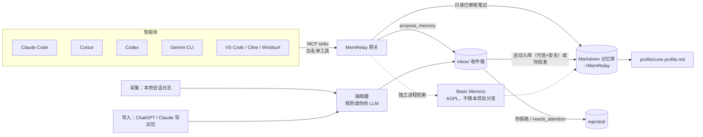

# MemRelay（忆桥）

[](https://github.com/theosunny/memrelay/actions/workflows/ci.yml)
[](LICENSE)
[](https://memrelay.zeabur.app)
[English](README.md)

> 官网 **CONFIGURE AFTER DEPLOY**。`https://memrelay.zeabur.app` 是占位域名，等 Zeabur 分配真实地址后再改。部署步骤：[packages/sync/ZEABUR.md](packages/sync/ZEABUR.md)。

**让你所有的 AI 智能体共用一份记忆，并逐渐成为你的数字分身。**

你跟 Claude Code 说过你用 pnpm，跟 Cursor 说过你的时区，跟 ChatGPT 讲过你的项目，可一换工具就全忘了。MemRelay 让它们共用**一份属于你的个人记忆**：存在你本机的普通 Markdown 文件里，每条记忆都有出处。**默认全自动 + 安全护栏**：可信来源、高置信提议会直接写入记忆库；密钥/注入/低置信/取代他人记忆等进入 `needs_attention`。人工审核是可选升级（`strict`），不是默认负担。

> 状态：**v0.1.0**，面向开发者的预览版，尚未发布到 PyPI。欢迎反馈。
> 🧪 = 已在 `main` 分支实现、将随 v0.2 发布，尚未正式发版。

## 功能

| | 功能 | 状态 |
|---|---|---|
| 🔌 | **接入**：通过 MCP 接入各智能体，自动写配置、先备份、一条命令回滚；`connect --all` 向导 | ✅ v0.1 |
| 📥 | **采集**：增量读取本地智能体历史（Claude Code、Codex、Gemini CLI）；`--watch` + 开机自启 | ✅ v0.1 |
| 📦 | **导入**：ChatGPT / Claude.ai 官方数据导出包（自动在“下载”里找，导入前询问） | ✅ v0.1 |
| ✅ | **审核策略**（默认 `auto` / `assist` / `strict`）：可信且安全的写入自动入库；其余进隔离队列或收件箱（命令行 + 本机网页） | ✅ v0.1 |
| 🛡️ | **网关**：白名单 MCP 工具，智能体除 `propose_memory` 外只读；密钥打码、注入标记 | ✅ v0.1 |
| 🧭 | **核心画像**：由已审核记忆生成，每条都链接到来源 | ✅ v0.1 |
| 🇨🇳 | 国内友好：嵌入模型下载自动回退 hf-mirror.com；豆包 / Kimi / 千问 提供引导式配置 | ✅ v0.1 |
| ⏳ | 时间维度记忆（`valid_from` / `valid_to` / `superseded_by`）、`recall(as_of=…)`、分层 `events/YYYY/` | 🧪 v0.2（已在 `main`） |
| 🔁 | 整理建议（新增 / 更新 / 取代 / 无需改动），批准后才执行，从不自动删除 | 🧪 v0.2（已在 `main`） |
| 🪞 | 反思：带引用的日报 / 周报；“Dream”大整理前打 git 快照、可一键回滚 | 🧪 v0.2（已在 `main`） |
| ✍️ | 只基于你本人文字的风格卡和决策原则；`answer_as_me` / `draft_as_me`（只出草稿） | 🧪 v0.2（已在 `main`） |
| 📏 | 分身保真度评估（“分身答得像不像我”） | 🧪 v0.2（已在 `main`） |
| 🌐 | 限定范围的“问我的分身”分享、A2A、手机分享面板、浏览器扩展 | 🗓 计划中 |

## 工作原理



- 存储和检索由 [Basic Memory](https://github.com/basicmachines-co/basic-memory) 完成，MemRelay 以独立程序方式通过 MCP stdio 调用它，从不 import、也不打包它。
- MemRelay 补上它周边缺的部分：收件箱审核、策略网关、客户端接入、采集与导入，以及画像层。

详见 [docs/architecture.md](docs/architecture.md)。与 OpenViking、Supermemory、Basic Memory、Mem0 的定位对比见 [docs/comparison.md](docs/comparison.md)。

## 支持的客户端

| 客户端 | 自动接入（写 MCP 配置） | 采集历史 | 说明 |
|---|---|---|---|
| Claude Code | ✅ `~/.claude.json` | ✅ `~/.claude/projects/**.jsonl` | |
| Cursor | ✅ `~/.cursor/mcp.json` | ❌ | 聊天记录存在未公开的 SQLite 里 |
| Claude Desktop | ✅ macOS / Windows；Linux 用社区路径 | ❌ | 接入前先退出应用 |
| Windsurf（Cascade） | ✅ `~/.config/devin/mcp_config.json` | ❌ | |
| Codex CLI / IDE | ✅ `~/.codex/config.toml`（保留注释） | ✅ `~/.codex/sessions/**/rollout-*.jsonl` | 支持 `CODEX_HOME` |
| Gemini CLI | ✅ `~/.gemini/settings.json` | ✅ `~/.gemini/tmp/*/chats/session-*.jsonl` | |
| VS Code（GitHub Copilot） | ✅ `~/.copilot/mcp-config.json` | ❌ | |
| Cline（命令行） | ✅ `~/.cline/data/settings/cline_mcp_settings.json` | ❌ | |
| Cline（VS Code 插件） | ✅ 仅当插件数据目录已存在 | ❌ | 来源为第三方资料 |
| 豆包 / Kimi / 通义千问 桌面版 | 🧭 引导：输出配置 JSON 和步骤，不写任何文件 | ❌ | 未找到官方配置路径 |
| ChatGPT / Claude.ai（网页） | — | 📦 通过官方数据导出包导入 | |

所有路径及出处见 [docs/client-config-paths.md](docs/client-config-paths.md)。

## 快速开始

需要 [uv](https://docs.astral.sh/uv/getting-started/installation/) 和 Python ≥ 3.11。

**macOS / Linux**

```bash
uv tool install basic-memory      # 存储/检索后端（AGPL-3.0，需单独安装）
uv tool install "git+https://github.com/theosunny/memrelay#subdirectory=packages/core"
memrelay init
memrelay connect --all            # 发现本机智能体，逐个预览改动并确认
```

**Windows（PowerShell）**

```powershell
powershell -ExecutionPolicy ByPass -c "irm https://astral.sh/uv/install.ps1 | iex"
uv tool install basic-memory
uv tool install "git+https://github.com/theosunny/memrelay#subdirectory=packages/core"
memrelay init
memrelay connect --all
```

重启各智能体，然后问其中一个：“你对我了解多少？”

**macOS 桌面应用。** 在 `packages/desktop` 里执行 `npm install && npm run tauri build`。未签名的 `.app` 在 `src-tauri/target/release/bundle/macos/忆桥分身.app`，`.dmg` 在 `src-tauri/target/release/bundle/dmg/`。先安装命令行程序，从访达打开时才能找到它（不依赖终端 PATH）：

```bash
uv tool install "git+https://github.com/theosunny/memrelay#subdirectory=packages/core"
uv tool install "git+https://github.com/theosunny/memrelay#subdirectory=packages/sync"
```

签名和局域网同步的说明见 [packages/desktop/README.md](packages/desktop/README.md)。

## 下载

官网：[https://memrelay.zeabur.app](https://memrelay.zeabur.app)（**CONFIGURE AFTER DEPLOY**）。

**macOS。** 官网上的按钮指向 [GitHub Releases 最新版](https://github.com/theosunny/memrelay/releases/latest)。还没有 `.dmg` 或 `.app.zip` 时，按钮写着「即将发布」。在 Mac 上进入 `packages/desktop`：

```bash
npm install
npm run tauri build
```

未签名的 `忆桥分身.app` 在 `src-tauri/target/release/bundle/macos/`，`.dmg` 在 `src-tauri/target/release/bundle/dmg/`。第一次请右键打开。先安装上面的两个命令行程序，从访达打开才能找到它们。推送 `v*` tag 会跑 `.github/workflows/release-macos.yml`，把未签名安装包挂到 Release。不需要 Apple 证书。

**手机。** 官网部署之后打开 `https://memrelay.zeabur.app/m/`，加到主屏幕。原生工程在 `packages/mobile`。

**同步。** 桌面和手机的设置里都有「同步服务」。官方占位地址：`https://memrelay-sync.zeabur.app`（**CONFIGURE AFTER DEPLOY**）。留空则用 `http://127.0.0.1:8790`。改地址后，在电脑上重新生成配对码。钥匙只留在设备上，服务器只存密文。自建和 Zeabur 步骤见 [packages/sync/ZEABUR.md](packages/sync/ZEABUR.md)。

**中国大陆用户**：Basic Memory 首次使用时要从 Hugging Face 下载一个小的嵌入模型。MemRelay 会先检测 `huggingface.co` 是否可达，不可达时自动把 `HF_ENDPOINT` 设为 `https://hf-mirror.com`。你自己设置过 `HF_ENDPOINT` 时以你的为准；在 `config.toml` 里写 `hf_endpoint = "off"` 可关闭这项检测。想让 `uv` 安装更快，也可以把 `UV_INDEX_URL` 设成你信任的 PyPI 镜像。

## 常用命令

```bash
memrelay capture all              # 采集 Claude Code + Codex + Gemini CLI → 记忆库（auto）或收件箱
memrelay status                   # review.mode、收件箱 / needs_attention、近期自动写入
memrelay autostart install --dry-run   # 先查看 launchd / systemd / 任务计划 的配置
memrelay import scan              # 在“下载”里找 ChatGPT / Claude 导出包
memrelay import run               # 每个包导入前都会询问
memrelay review                   # 本机网页审核（仅 127.0.0.1）
memrelay inbox list | approve <id> | reject <id>
memrelay profile build            # 重新生成 profile/core-profile.md
memrelay connect rollback <agent> # 恢复该智能体之前的配置
memrelay doctor                   # 查看路径和已检测到的组件
```

**v0.2 分身命令（已在 `main`）：**

```bash
memrelay consolidate              # 为收件箱条目生成 新增/更新/取代/无需改动 建议
memrelay reflect daily | weekly   # 带引用的日报 / 周报 → 收件箱
memrelay dream                    # git 快照 + 合并建议；回滚：memrelay dream rollback <sha>
memrelay profile style            # 只用你本人的消息生成风格卡 → 收件箱
memrelay profile principles       # 证据 ≥2 的决策原则 → 收件箱
memrelay ask "我现在住哪？" --as-of 2023-06-01
memrelay draft "回复同事：本周发版安排" --channel work   # 只输出草稿，绝不发送
memrelay eval init && memrelay eval run
```

画像层可选接入 LLM（默认离线规则），支持任意 OpenAI 兼容接口：在 `config.toml` 写 `persona_llm = "deepseek"`（或 `openai`、`qwen`、`kimi`、`ollama`、`glm`、`openai-compat`）；key 从对应环境变量读取，如 `DEEPSEEK_API_KEY`。

**智谱 GLM Coding Plan**（抽取器 + 画像）：设 `extractor = "openai"`、`persona_llm = "glm"`，环境变量 `GLM_API_KEY`，并把 `[llm]` 指到 Coding 端点（**仅适用于 Coding Plan 密钥**，普通 GLM key 无效）：

```toml
extractor = "openai"
persona_llm = "glm"
[llm]
base_url = "https://open.bigmodel.cn/api/coding/paas/v4"
model = "glm-5.3-flash"
api_key_env = "GLM_API_KEY"
```


## 安全模型

- **默认全自动 + 安全护栏（`review.mode = "auto"`）**：智能体、采集、导入仍只能**提议**；来自可信本地采集（claude-code、codex、gemini-cli、cursor）与白名单 MCP 智能体、且置信度足够的提议会自动写入记忆库。仍进 `needs_attention` / 收件箱的：密钥/PII 打码、注入标记、置信度 < 0.55、sensitivity 为 personal/secret、关于他人的笔记、会 SUPERSEDE 的矛盾、画像文件替换。在 `config.toml` 设 `review.mode = "strict"` 可恢复「全部人工审核」；`assist` 则仅对可信+高置信自动。永不自动发送；`draft_as_me` 只出草稿；不对智能体暴露 forget/delete。用 `memrelay status` 或周反思里的自动写入摘要浏览。产品设计见 [docs/persona-design.md](docs/persona-design.md)。
- **白名单网关**：智能体只能看到固定几个 MCP 工具：`get_profile`、`recall`、`read_memory`、`recent`、`propose_memory`；`main` 分支上另有 `answer_as_me`、`draft_as_me`。它们不能编辑、删除或移动笔记。
- **分身护栏**（`main` 分支）：
  - 分身的每个回答都带 AI 分身声明、引用和置信度。
  - 索要密钥或要求导出全部记忆的请求会被拒绝。
  - LLM 输出中没有引用的内容会被丢弃。
  - 代拟草稿只使用不高于该渠道可见性的记忆（`work`、`friends`、`public`）。
  - 每次调用都记在本机 `audit/` 日志里。
- **读取过滤**：收件箱、已拒绝、已归档、已过期以及 `secret` 级别的笔记，永远不会返回给智能体。
- **脱敏**：写入时会给密钥和令牌打码；疑似提示注入的内容会被标记，审核时提醒你。
- **没有发送能力**：MemRelay 不接任何邮件、聊天或发帖接口；`draft_as_me` 只返回文字草稿。
- **本地优先**：记忆库就是你磁盘上的文件；网页审核只监听 127.0.0.1，每次启动生成随机令牌，并做 CSRF 校验。
- **配置改动可撤销**：写任何客户端配置之前都会先备份。

发现安全漏洞请按 [SECURITY.md](SECURITY.md) 报告。

## 常见问题

**为什么不直接用 Mem0 / Letta / Zep / OpenViking / Supermemory？** 它们是很好的记忆**引擎**，通常给你自己开发的应用或云端空间用。MemRelay 面向的是同时用很多现成智能体的**个人**：接入、一份共享记忆（默认自动入库 + 护栏，人工审核可选）、分身（`answer_as_me` / `draft_as_me`）。我们把 MemRelay 定位为「中继 + 分身」，引擎做成可选后端——详见 [docs/comparison.md](docs/comparison.md)。

**会抓取封闭应用（微信、豆包、Kimi……）的数据吗？** 不会。MemRelay 只读取各工具按公开文档写在你本机的文件，以及你自己下载的官方数据导出包。应用没有公开 MCP 配置路径的，我们只给操作步骤，不去猜路径。

**Basic Memory 是 AGPL，对我有影响吗？** MemRelay 是 Apache-2.0，只是把你自己安装的 Basic Memory 当独立程序**运行**，不 import、不修改、也不分发它。详见 [NOTICE](NOTICE)。

**需要大模型或 API key 吗？** 不需要。默认抽取器基于规则，完全离线。你也可以接入任意 OpenAI 兼容接口（OpenAI、DeepSeek、通义千问、Kimi、本地 Ollama……）；key 从环境变量读取，MemRelay 不保存。

**能手动编辑记忆吗？** 可以，它们就是 Markdown 文件，用任何编辑器或 Obsidian 打开记忆库即可。

## 路线图

- **v0.2 数字分身**：
  - 时间维度记忆和按时间点查询
  - 整理建议
  - 日报 / 周报反思，Dream 大整理（git 可回滚）
  - 风格卡和决策原则
  - `answer_as_me` / `draft_as_me`
  - 保真度评估
- **v0.3**：
  - 由宿主智能体代做抽取（无需 key）
  - 更完善的审核界面
  - 更多采集来源（等其格式有公开文档后）
- **v1.0**：
  - 限定范围的“问我的分身”分享（带审计和限流）
  - A2A Agent Card
  - 手机分享面板
  - 浏览器扩展

## 参与贡献

欢迎提 issue 和 PR，中文英文都可以。我们用 DCO（`git commit -s`），不需要签 CLA。先看 [CONTRIBUTING.md](CONTRIBUTING.md) 和 [接入/采集开发指南](docs/adapter-authoring.md)。

## 许可证

Apache-2.0，见 [LICENSE](LICENSE) 和 [NOTICE](NOTICE)。Basic Memory 是 Basic Machines 的独立 AGPL-3.0 项目，不随 MemRelay 分发。
