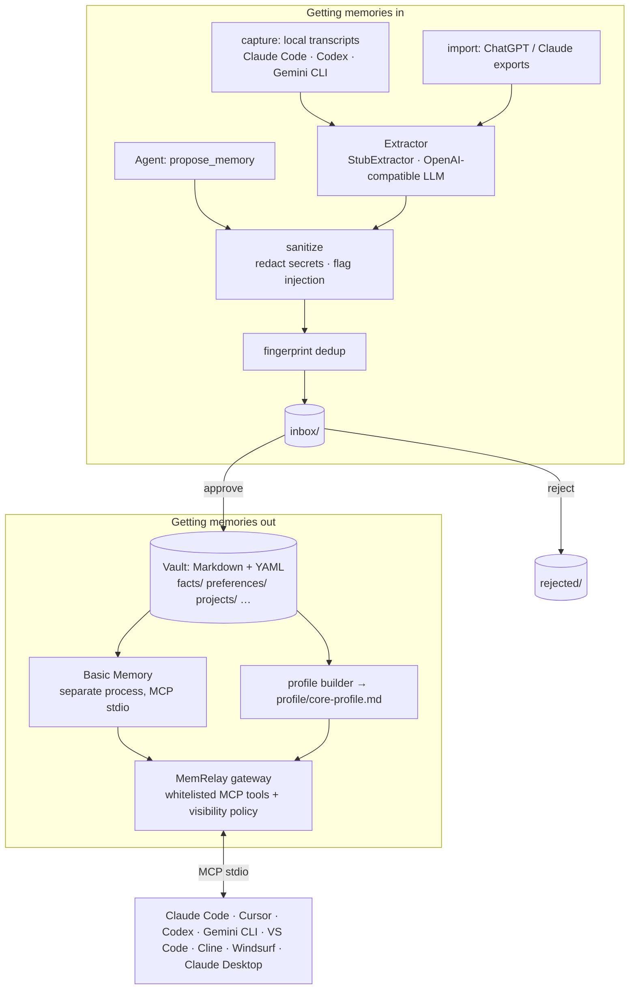

# Architecture

MemRelay is a thin, policy-heavy layer around an existing memory engine. It does three jobs:
it connects your agents, it gets memories in (with your review), and it gets them out safely.

## Components (packages/core/src/memrelay)

| Module | Role |
|---|---|
| `schema.py` | `Note` model: Markdown + YAML frontmatter with provenance (`source_agent`, `source_ref`, `captured_at`), temporal fields (`valid_from`, `valid_to`, `superseded_by`), `visibility`, `sensitivity`, `confidence` with decay |
| `vault.py` | One folder per memory layer; hidden areas (`inbox/`, `rejected/`, `archive/`, `sources/`) never served |
| `inbox.py` | Review queue. `propose` sanitises + dedups; `approve` moves into the right layer; `reject` keeps an audit copy |
| `review.py` | `review.mode` policy (`auto`/`assist`/`strict`): decide + auto-approve + `needs_attention` + auto-applied log/digest |
| `gateway.py` | The only MCP surface agents see (FastMCP). Whitelisted tools; read filters; writes only via `propose_memory` |
| `backends/` | Pluggable `MemoryBackend` (`search` / `get_note` / `remember`). `basic_memory` (default), `local`, `openviking` stub. No delete/forget on the interface. See [comparison.md](comparison.md). |
| `backend.py` | Thin re-export of `backends` for older imports |
| `adapters/` | One class per client: config path per OS (cited), backup, install/uninstall, rollback |
| `wizard.py` | `connect --all`: discover → preview (dry-run) → confirm each |
| `capture/` | Incremental, read-only transcript readers (`JsonlTranscriptSource` + per-tool parsers) with byte-offset cursors |
| `extract/` | `Extractor` protocol; rule-based stub and OpenAI-compatible LLM extractor (prompt adapted from Mem0, Apache-2.0) |
| `importers.py` | ChatGPT / Claude.ai export detection & import; raw archive via Basic Memory's own importers |
| `profile.py` | Core profile (Letta-style "core memory"), every line linked to its source |
| `autostart.py` | launchd / systemd --user / Task Scheduler entries for `capture all --watch` |
| `web.py` | Local review UI (Starlette, 127.0.0.1, token + CSRF) |
| `hf.py` | `HF_ENDPOINT` mirror fallback for the embedding download |
| `temporal.py` | v0.2: validity windows; "now" vs point-in-time visibility |
| `consolidate.py` | v0.2: ADD/UPDATE/SUPERSEDE/NOOP plans (rules or LLM), applied on approval, archive-not-delete |
| `reflect.py` / `dream.py` | v0.2: daily/weekly reflections with validated citations; Dream with git snapshot + rollback |
| `persona.py` | v0.2: style card (user's own words only) and principles (≥2 evidence) |
| `twin.py` | v0.2: `answer_as_me` / `draft_as_me` with disclosure, citations, refusals, visibility ceiling, audit log |
| `llm.py` | v0.2: OpenAI-compatible chat LLM + presets (DeepSeek, Qwen, Kimi, Ollama) and `StubLLM` |
| `evals.py` | v0.2: fidelity eval harness over `eval/qa.yaml` |

## Design rules

1. **Human in the loop for every write.** Nothing reaches the vault without `approve`.
2. **Don't reinvent the wheel.** Storage/indexing = Basic Memory by default; OpenViking /
   Supermemory are optional engines behind `backends/` — do not rebuild their retrieval
   stacks here ([comparison.md](comparison.md)). MCP = FastMCP; file watching = watchfiles;
   TOML = tomlkit. Borrowed ideas are credited (below).
3. **Never guess paths.** Every client/capture path is cited in
   [client-config-paths.md](client-config-paths.md); undocumented apps get guided setup.
4. **Plain files.** The vault is Markdown you can read, edit, grep, and sync with Git/Syncthing.
5. **Separate process for AGPL code.** Basic Memory is executed, never imported or bundled.
6. **No outbound actions.** The gateway has no send/post/email capability.

## Prior art we build on

- Mem0 (arXiv:2504.19413), prompts in `mem0/configs/prompts.py` (Apache-2.0): fact extraction prompt and the ADD/UPDATE/DELETE/NOOP idea.
- Graphiti / Zep (arXiv:2501.13956): temporal validity and invalidation instead of deletion.
- MemGPT / Letta (arXiv:2310.08560): core vs archival memory.
- Generative Agents (arXiv:2304.03442): importance, reflection, and the question-then-answer insight step.
- Basic Memory: Markdown knowledge base + MCP server + importers (AGPL-3.0, run as a separate program).
